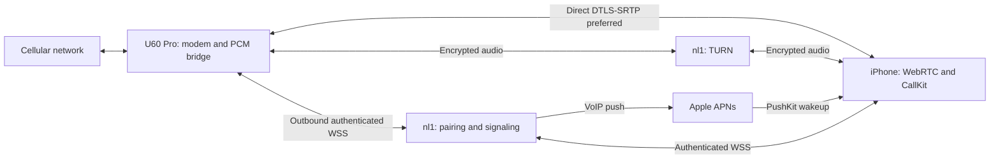

# Remote calling

The `feat/remote-calling` branch implements internet calling through the SIM in a
U60 Pro. The iPhone can use mobile data or any Wi-Fi connection. Neither endpoint
needs a VPN or an overlay network. Both endpoints need internet access.

The implementation includes the server, router call controller and audio adapter,
and iPhone WebRTC, CallKit, and PushKit integration. **Cellular audio on the real
router and actual PushKit delivery still require device testing.** L17 has passed
native CallKit incoming/outgoing, answer, mute, hangup, audio activation, and a
synthetic incoming call reported while the app was in the background. That
background fixture uses a short background task; it does not prove PushKit wakeup.
The inspected router had no SIM. A compiled adapter is not proof that its vendor
audio path works.

## Architecture



Signaling is available at `https://nl1.gmdns.net/openu60`. The service binds to
loopback TCP 46170 behind a dedicated Nginx virtual host. TURN listens on UDP/TCP
3478 and UDP relay ports 49160–49200. Cloudflare Tunnel can carry HTTPS/WSS
signaling to an HTTP origin; the public TURN route must remain independently
reachable. Router administrative APIs are never exposed by this service.

`server/` uses Bun 1.3.14 and SQLite. `zte-agent/src/remote_calling/` uses Tokio,
webrtc-rs 0.17.1 with a [local ICE TCP patch](../vendor/webrtc-ice/OPENU60_PATCH.md),
and PCMU/G.711 at 8 kHz. iOS uses WebRTC M155, pinned to the
155.0.0 binary package. TURN relays encrypted DTLS-SRTP without terminating the
media encryption.

## Pairing and iPhone behavior

Use Settings → Remote calling while logged into the router on its local network.
The server administrator creates a one-time invitation using the command in
[the server guide](../server/README.md). Enter the HTTPS service address and that
invitation in the router setup section. The router persists a generated device
credential before enrollment; an identical retry recovers its enrollment.

The app obtains a five-minute pairing code from the enrolled router, creates its
own credential before pairing, and stores the completed pairing in the iPhone
Keychain. After pairing, the original call-screen entry opens remote calling.
The login screen also provides remote calling without requiring a local router
login. Its sheet has an explicit Close button. The standalone calling screen has
a Back button for returning to router management. Returning does not end an
ongoing CallKit call.

Calls use CallKit for dialing, answering, ending, mute, DTMF, and audio-session
activation. Speaker routing uses WebRTC's coordinated audio session. PushKit
reports incoming calls to CallKit immediately before reconnecting signaling.
Malformed or expired VoIP notifications still complete the system reporting
lifecycle and are ended; they cannot disable another active call's audio.

Beexio B.V. signs bundle `com.beexio.openu60` with its dedicated development push
profile. `OpenU60PushEnvironment` is `sandbox`, matching that profile. A production
build must change both signing and the registered push environment together.
Live Activity push configuration is independent of VoIP incoming-call push.

One phone is paired with one router. Re-pairing revokes the previous phone and its
push token. Forgetting pairing revokes the server credential before clearing the
local pairing; an already revoked credential can also be forgotten. Enrollment
and phone pairing cannot be revoked while a call is active.

## Router lifecycle and failure handling

The router is the WebRTC offerer. Outgoing dialing and incoming answering wait
for a media connection before submitting ATD or ATA. The audio helper starts
only when the modem reports an active call. An active call is advertised with
`mediaReady=true` only after actual PCM arrives from that helper.

Each call and command has a stable UUID. The server persists a command before
sending it. The agent persists its execution journal before touching the modem.
The server includes the original 20-second expiry on every delivery. Retries keep
that expiry. The agent subtracts queue and media setup time using a monotonic clock
and cancels work still waiting for the shared AT port when the operation expires
or its call ends. Cancellation only affects commands belonging to that call.
An identical request replays its recorded result. After a process crash, an
unfinished command becomes `execution_unknown`; it is never dialed again.
The execution journal keeps bounded completed history and a durable event queue.

The agent serializes remote modem work with existing local AT traffic. A modem
snapshot must end in OK and contain valid CLCC records. Cleanup checks the
physical call ID and direction, or the dialed number if an ID is not yet known.
It refuses to hang up a different or unidentified call. Shutdown cancels work
waiting for the AT lock and reconciles an already submitted command before
cleaning up its call. Restart does not reclaim an unidentified physical call.

Transient signaling loss does not stop an established direct media connection
or modem polling. Reconnect replays durable events and pending operations. The
phone requests a new media session if it has no existing peer. Each negotiation
receives fresh one-hour TURN credentials. Events include a sequence and observed
time: an old incoming ring replay is recorded as ended without ringing again.

Operation expiry, media failure, unsupported modem state, queue exhaustion,
provider rejection, and storage failure are explicit outcomes. Temporary APNs
failures retry through a persistent outbox only while the call remains ringing.
Invalidated push tokens are removed. Transport attempts have finite deadlines.
An uncertain modem operation is not a reason to issue another dial.

## Firmware audio boundary

The initial adapter supports the inspected EU/Poland firmware
`STD_PL_MU5250V1.0.0B02`. It pins `/usr/bin/zte_route_hal_voice_test` to SHA-256
`14f02d6d8af581cf08102be83ecd08f332d529a5a4a38efc455e832fcd672f11`.
A different helper fails with `unsupported_audio_helper`.

Static inspection established the helper's four imported `zte_rtp_*` hooks, an
8 kHz configuration, and a receive loop expecting 320-byte frames. The preload
adapter in `native/audio-bridge/` replaces those hooks with a private inherited
Unix datagram socket, using explicit PCM16LE/mono framing. It opens no network
listener, writes no audio file, and inherits no router or APNs credentials.
The helper is launched with the arguments used by the firmware's vendor policy.
The adapter's ABI, channel direction, and cellular routing must be checked during
a real call before treating this firmware path as supported.

The device inspection also found Qualcomm Audio Graph Manager, its ready marker,
and AUXPCM ALSA endpoints. Their streams were closed. SLIC/VOIP character devices
were absent, and `voice_work_type` reported the literal `null`. This change does
not load SLIC modules, rewrite vendor voice modes, change USB mode, or assume an
ALSA playback label establishes the correct cellular uplink.

Vendor binaries and raw device captures remain outside Git.

## Build and install

From the project root:

```sh
cargo zigbuild --locked --release --target aarch64-unknown-linux-musl -p zte-agent
sh native/audio-bridge/build.sh
python3 tools/install-router.py --restart
```

The installer requires exactly one ADB device, or an explicit `--serial`. Run it
while the modem is idle. It verifies the helper and uploaded artifact hashes,
installs atomically, retains `/data/zte-agent.before-remote-calling` for rollback,
and restarts through the existing startup script. Startup, passwords, APNs files,
and remote pairing files are preserved. Legacy adbd exit status is checked with
a remote completion marker. Installation on the unavailable router was not run.

Generate the Xcode project from `mobile/ios/OpenU60/project.yml`, then build the
OpenU60 scheme. The configured Beexio profile and its extension signing must be
available to produce a device-signed app. Do not replace private profile or key
files through source-control tooling.

## Verification and remaining device checks

Verification on 2026-10-20 covered:

- The full agent unit suite, including idempotent crash recovery, malformed modem
  snapshots, caller-number parsing, and μ-law conversion.
- Server tests with real WebSocket connections and temporary SQLite databases;
  authorization, pairing, command replay, expiry, outbox retries, presence,
  token invalidation, and stale incoming events are exercised.
- Four native adapter tests using synthetic PCM and private socket pairs.
- AArch64 musl builds of the agent and native adapter, and a Beexio-signed iOS build.
- Isolated Simulator regression checks against the production iOS manager: mute
  survives renegotiation, stale media/ended events cannot affect a newer call,
  a call arriving during microphone permission prevents a conflicting outgoing
  call, local hangup completes before its network acknowledgment, and stale or
  stalled signaling reconnects while retaining existing media.
- Actual Google WebRTC M155 and Rust SDP/ICE/DTLS interoperability. The real
  Simulator client receives synthetic G.711 RTP from the production Rust media
  implementation. The microphone is disabled, so this is downlink evidence only.
- Native CallKit on L17 with an in-memory synthetic gateway: incoming/outgoing,
  answering, mute, hangup, activation/deactivation, and background call reporting.
- Public HTTPS/WSS pairing, command/result, media routing, and event acknowledgment
  through nl1 using synthetic endpoints, followed by credential revocation.
- Real two-peer DTLS-SRTP tests forced through nl1 TURN over UDP and TCP, verifying distinct G.711
  payloads in both directions. This tests the network media engine, not the modem.

The lifecycle and native media checks use a dedicated booted Simulator:

```sh
sh mobile/ios/scripts/test_remote_calling.sh <simulator-uuid>
sh mobile/ios/scripts/test_native_media.sh <simulator-uuid>
```

The optional native CallKit fixture is compiled only with both `DEBUG` and
`OPENU60_NATIVE_CALLKIT_PROBE`. It preserves the complete app and opens a sheet
only when explicitly launched with `--native-callkit-probe`; Back to OpenU60
closes it. `build_native_callkit_probe.sh` builds this optional full app for an
explicit private-LAN fixture URL. The distributed app has neither this build flag
nor that URL. Do not replace the app with a standalone test shell.

After the SIM arrives, install the built agent and app, pair the real devices,
and verify outgoing and incoming calls with a voice-capable SIM and carrier IMS
registration. Check both audio directions, mute, speaker/Bluetooth routing, DTMF,
lock-screen/background/terminated-app incoming calls, caller cancellation before
answer, local and remote hangup, and recovery after losing signaling or internet.
Native PushKit delivery with the installed app's real VoIP token is unverified.
The server health flag indicates configuration, not Apple delivery success.

This implementation supports one call at a time. Hold, conference calls, transfer,
and call waiting control are explicitly unsupported. It does not provide offline
calling or guarantee carrier voice support on a particular SIM/firmware.
