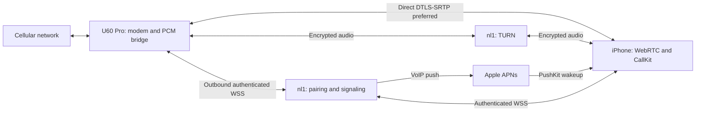

# Remote calling

The `feat/remote-calling` branch implements internet calling through the SIM in a
U60 Pro. The iPhone can use mobile data or any Wi-Fi connection. Neither endpoint
needs a VPN or an overlay network. Both endpoints need internet access.

The implementation includes the server, router call controller and audio adapter,
and iPhone WebRTC, CallKit, and PushKit integration. L17 has received real Apple
VoIP notifications while the complete app was in the background with its signaling
connection deliberately closed. Native CallKit activation, bidirectional PCMU
traffic, mute, speaker/receiver routing and clean hangup have been observed against
a synthetic router on the public service. **Cellular audio on the real U60 still
requires a SIM and device testing.** Synthetic RTP does not verify its vendor PCM
adapter or audible carrier speech.

## Architecture



Signaling is available at `https://nl1.gmdns.net/openu60`. The service binds to
loopback TCP 46170 behind a dedicated Nginx virtual host. TURN listens on UDP/TCP
3478 and UDP relay ports 49160–49200. Cloudflare Tunnel can carry HTTPS/WSS
signaling to an HTTP origin; the public TURN route must remain independently
reachable. Router administrative APIs are never exposed by this service.

`server/` uses Bun 1.3.14 and SQLite. `zte-agent/src/remote_calling/` uses Tokio,
webrtc-rs 0.17.1 with a [local ICE TCP patch](../vendor/webrtc-ice/OPENU60_PATCH.md),
and PCMU/G.711 at 8 kHz. iOS uses WebRTC M155, pinned to the
155.0.0 binary package. TURN relays encrypted DTLS-SRTP without terminating the
media encryption.

## Automatic management paths

The normal app prefers authenticated LAN management, then a direct WebRTC data
channel, then the existing HTTPS/WSS agent relay. P2P management is independent
of call media and does not request microphone access. The existing server is the
authenticated rendezvous; Hysteria and a VPN are not involved.

An enrolled agent advertises `peer_register` on its authenticated socket. A paired
phone sends `peer_open` with a fresh session UUID. The server introduces only that
phone and its router, sends `peer_session` with a five-minute lease and STUN
addresses, and forwards scoped `peer_signal` SDP/ICE messages. The router offers
an ordered, reliable `openu60-management-v1` data channel. DTLS certificate
fingerprints travel through authenticated signaling and bind the direct peer to
its admitted session. A session-bound `peer_hello`/`peer_ready` exchange completes
readiness. TURN addresses are excluded from this management peer so a connection
reported as P2P is direct; failed punching uses the established agent relay.

Parallel dashboard reads share one introduction. Punching waits at most four
seconds per attempt, direct requests wait at most four seconds, and failed peers
back off for fifteen seconds while relay requests continue. Local probes are
repeated after their short cache expires, allowing a return to LAN automatically.
Network failure, lease expiry, server selection, socket replacement/disconnection,
or revocation closes the affected peer. Each phone has an independent session;
there is no primary phone. Sessions and uncompleted negotiations are bounded and
are recreated after a process restart.

Management requests retain the same effect UUID, method, path, and body across
LAN, P2P, and relay. All three enter the router's existing management validator
and durable write journal. A lost response cannot execute an uncertain write a
second time. Server-admitted call commands also try LAN, then P2P, then relay,
retaining the canonical operation ID and expiry. Call ownership and result
delivery remain with the existing durable calling service.

Direct call delivery includes a server admission MAC bound to the phone UUID,
request UUID, call UUID, action, original expiry, number, and DTMF digits. The
router verifies it against its enrollment credential before admitting the call
command; another paired phone cannot submit a forged or modified operation on
that channel. The canonical MAC input is the UTF-8 encoding of these eight
NUL-separated fields: `OpenU60 call admission v1`, phone ID, request ID, call ID,
action, decimal expiry, number or empty string, digits or empty string. UUIDs are
lowercase. HMAC-SHA256 uses the raw SHA-256 of the router token as its key and
returns unpadded base64url. The server already holds that verifier; it does not
need the raw router token. Older services without direct admission proof continue
using the existing call relay.

Data-channel messages use binary frames: version byte `1`, 16 raw UUID bytes,
big-endian 32-bit total length and offset, then up to 12,288 payload bytes. Frames
must arrive in order for each UUID. Messages are bounded to 786,432 bytes, router
requests to 98,304 bytes, and HTTP response bodies to 524,288 bytes. At most eight
partial messages are retained for ten seconds. Request bodies and responses are
the existing JSON/base64 contracts. No application payload is stored or forwarded
by the rendezvous.

## Pairing and iPhone behavior

### Connect with a device string

For an already enrolled U60, open its touchscreen Wi-Fi panel and choose
**Connect app**. The screen displays a QR code plus `U60-<router UUID>` and its
configured server. In the normal iPhone app, choose **Connect with device string**
then **Scan U60 QR code**. Scanning selects the embedded server, preserving all
other profiles, and automatically connects with the saved router password. With
no saved password, the password field opens for entry. A server profile already
authorized for another device or holding another device's pending approval is
left unchanged with an explicit error. Manual device-string entry and the server
selector remain available.

The QR is UTF-8 JSON with `type: "openu60-connect"`, `version: 1`, `device` and
`server`. It contains no password or phone authorization. The scanner accepts only
this version, a valid U60 UUID and the same HTTPS URL contract as manual server
entry. The native QR canvas has a separate white quiet zone; unavailable metadata
hides any previous code. The App shares its existing camera scanner with eSIM.

The connection string is a stable device identifier, not an authorization token.
The server publishes the online router's P-256 public key from its authenticated
registration. CryptoKit HPKE encrypts the password to that key using RFC 9180
P-256/HKDF-SHA256/AES-256-GCM. The router alone decrypts and verifies it. The
router UUID, request UUID, and generated phone credential are authenticated
associated data; the sealed login expires after sixty seconds. Password attempts
are bounded on the router and at the server. The rendezvous is trusted for device
discovery and key distribution, as it is for existing signaling.

The phone persists its pending credential before contacting the device. After
password approval, the server durably creates that phone's independent endpoint
before replying. Retrying a lost response recovers the same endpoint. A rejected
password allows a fresh corrected attempt. The server persists only request
metadata and credential hashes, not the password envelope or plaintext. The
router's dedicated connection identity is generated and retained by its normal
agent under `/data/openu60-connect/`; installers preserve it along with the
existing pairing files. A malformed existing identity fails explicitly.

### Advanced enrollment

Open Calls and tap the connection indicator while logged into the router on its local network.
The server administrator creates a one-time invitation using the command in
[the server guide](../server/README.md). Enter the HTTPS service address and that
invitation in the router setup section. The router persists a generated device
credential before enrollment; an identical retry recovers its enrollment.

The app obtains a five-minute pairing code from the enrolled router, creates its
own credential before pairing, and stores the completed pairing in the iPhone
Keychain. After pairing, the original call-screen entry opens remote calling.
The login screen also provides remote calling without requiring a local router
login. Its sheet has an explicit Close button. The standalone calling screen has
a Back button for returning to router management. Returning does not end an
ongoing CallKit call.

Calls use CallKit for dialing, answering, ending, mute, DTMF, and audio-session
activation. Speaker routing uses WebRTC's coordinated audio session. PushKit
reports incoming calls to CallKit immediately before reconnecting signaling.
Malformed or expired VoIP notifications still complete the system reporting
lifecycle and are ended; they cannot disable another active call's audio.

Beexio B.V. signs bundle `com.beexio.openu60` with its dedicated development push
profile. `OpenU60PushEnvironment` is `sandbox`, matching that profile. A production
build must change both signing and the registered push environment together.
Live Activity push configuration is independent of VoIP incoming-call push.

Multiple phones can remain paired with one router. Adding a phone preserves the
existing phones, their management access, and their notification registrations.
Every paired phone receives incoming calls and complete SMS notifications. There
is no primary phone. The first admitted answer atomically claims the call and its
audio; other phones receive `answered_elsewhere` and close their CallKit UI.
Declining on one phone silences only that phone; the last decline hangs up the
modem. Outgoing calls and active audio remain owned by the initiating/answering
phone. Only that phone may send media, DTMF, or hangup for the active call.

The SMS list retains the firmware's pagination, dates and storage metadata, but
reads sender and body from the same local SMS database as notifications. Some
firmware encrypts those fields in ubus replies. The agent returns the sender as
text and the body as UTF-16BE hex, preserving the existing app contract. Missing
or invalid stored text fails the read; opaque ubus fields are never a fallback.
The iOS parser decodes only complete, valid UTF-16BE hex and preserves plain text.

Immediate App push and SMS forwarding share the native arrival event. The
firmware-specific stored-message event repair and its recovery procedure are
documented in [SMS arrival events](sms-notifications.md).

Forgetting pairing revokes only that phone before clearing its local pairing;
other phones remain connected. Explicit router-wide revocation still removes all
phones. Enrollment and phone pairing cannot be revoked while a call is active.
Previously revoked credentials remain revoked after upgrading; an affected phone
must pair again. A failed network connection never erases its local credentials.

Incoming call participants, the winning phone, command callers, and per-phone
push retries are durable. Reconnection after another phone answered receives an
ended snapshot rather than a new ring. Schema upgrades preserve existing outbox
rows and endpoint credentials; they do not reactivate revoked endpoints.

## Selecting servers

Home's connection details and the Calls connection sheet open the same Servers
list. Addresses can be added before deployment. Adding an address preserves the
current selection; selecting a row explicitly switches management and calling
to that server. There is no automatic server failover. HTTPS addresses support
custom ports and paths.

Each address retains its own active and pending pairing in the existing Keychain
item. The versioned format reads the previous single-server pairing without
discarding it. Switching never copies a credential to another address. A server
without a pairing stays unpaired, while other saved pairings keep the normal app
available. A paired-server switch refreshes SMS and VoIP registration. Selection
is persisted before replacing the signaling socket; failed persistence preserves
the current connection. Calls and unfinished call commands prevent selection.
Forgetting pairing affects only the selected address. Remove an address after
forgetting its pairing and selecting another server.

The router currently has one server enrollment. Local pairing checks that the
router is enrolled at the selected address. Multiple independently deployed
services require router enrollment/routing work; saving an address alone does
not connect the U60 to it. The existing transport remains HTTPS/WSS with WebRTC
media. A custom TLS/TCP or QUIC/UDP control listener is a separate implementation;
it is not exposed as a working address type in this version.

## Router lifecycle and failure handling

The router is the WebRTC offerer. Outgoing dialing and incoming answering wait
for a media connection before submitting ATD or ATA. The audio helper starts
only when the modem reports an active call. An active call is advertised with
`mediaReady=true` only after actual PCM arrives from that helper.

Each call and command has a stable UUID. The server persists a command before
sending it. The agent persists its execution journal before touching the modem.
The server includes the original 20-second expiry on every delivery. Retries keep
that expiry. The agent subtracts queue and media setup time using a monotonic clock
and cancels work still waiting for the shared AT port when the operation expires
or its call ends. Cancellation only affects commands belonging to that call.
An identical request replays its recorded result. After a process crash, an
unfinished command becomes `execution_unknown`; it is never dialed again.
The execution journal keeps bounded completed history and a durable event queue.

The agent serializes remote modem work with existing local AT traffic. A modem
snapshot must end in OK and contain valid CLCC records. Cleanup checks the
physical call ID and direction, or the dialed number if an ID is not yet known.
It refuses to hang up a different or unidentified call. Shutdown cancels work
waiting for the AT lock and reconciles an already submitted command before
cleaning up its call. Restart does not reclaim an unidentified physical call.

Transient signaling loss does not stop an established direct media connection
or modem polling. Reconnect replays durable events and pending operations. The
phone requests a new media session if it has no existing peer. Each negotiation
receives fresh one-hour TURN credentials. Events include a sequence and observed
time: an old incoming ring replay is recorded as ended without ringing again.
If the phone's selected direct path fails, it replaces that peer once with a
TURN-only peer while retaining CallKit ownership and mute. It requests media for
the same call; it never issues a second dial. Recovery is bounded and a failed
relay ends the call explicitly.

Operation expiry, media failure, unsupported modem state, queue exhaustion,
provider rejection, and storage failure are explicit outcomes. Temporary APNs
failures retry through a persistent outbox only while the call remains ringing.
Invalidated push tokens are removed. Transport attempts have finite deadlines.
An uncertain modem operation is not a reason to issue another dial.

## Firmware audio boundary

The initial adapter supports the inspected EU/Poland firmware
`STD_PL_MU5250V1.0.0B02`. It pins `/usr/bin/zte_route_hal_voice_test` to SHA-256
`14f02d6d8af581cf08102be83ecd08f332d529a5a4a38efc455e832fcd672f11`.
A different helper fails with `unsupported_audio_helper`.

Static inspection established the helper's four imported `zte_rtp_*` hooks, an
8 kHz configuration, and a receive loop expecting 320-byte frames. The preload
adapter in `native/audio-bridge/` replaces those hooks with a private inherited
Unix datagram socket, using explicit PCM16LE/mono framing. It opens no network
listener, writes no audio file, and inherits no router or APNs credentials.
The helper is launched with the arguments used by the firmware's vendor policy.
The adapter's ABI, channel direction, and cellular routing must be checked during
a real call before treating this firmware path as supported.

The device inspection also found Qualcomm Audio Graph Manager, its ready marker,
and AUXPCM ALSA endpoints. Their streams were closed. SLIC/VOIP character devices
were absent, and `voice_work_type` reported the literal `null`. This change does
not load SLIC modules, rewrite vendor voice modes, change USB mode, or assume an
ALSA playback label establishes the correct cellular uplink.

Vendor binaries and raw device captures remain outside Git.

## Build and install

From the project root:

```sh
cargo zigbuild --locked --release --target aarch64-unknown-linux-musl -p zte-agent
sh native/audio-bridge/build.sh
python3 tools/install-router.py --restart
```

The installer requires exactly one ADB device, or an explicit `--serial`. Run it
while the modem is idle. It verifies the helper and uploaded artifact hashes,
installs atomically, retains `/data/zte-agent.before-remote-calling` for rollback,
and restarts through the existing startup script. Startup, passwords, APNs files,
and remote pairing files are preserved. Legacy adbd exit status is checked with
a remote completion marker.

Generate the Xcode project from `mobile/ios/OpenU60/project.yml`, then build the
OpenU60 scheme with the Beexio team selected. Xcode manages the development
profiles for the dedicated `com.beexio.openu60` App ID and its extension, including
newly registered test devices. The profile must retain the development APNs
entitlement. Do not replace private profile or key files through source-control
tooling.

For operator-assisted setup, the normal server admin client can create a
single-use invitation file. Transfer that opaque file into the app's private
Documents directory as `openu60-router-invitation.private`, then open Calls and
choose "Use transferred server invitation". This visible action uses the same
router configuration and phone-pairing methods as manual setup; it never runs
automatically on launch. Only a bounded regular text file is accepted, and the
app removes it after successful pairing. If router enrollment succeeded but
phone pairing was interrupted, retry pairs the configured router without
resubmitting the consumed invitation. Neither transfer nor diagnostics should
print the invitation. The router and phone both need a working server route
during this setup.

## Verification and remaining device checks

Verification on 2026-10-20 covered:

- The full agent unit suite, including idempotent crash recovery, malformed modem
  snapshots, caller-number parsing, and μ-law conversion.
- Server tests with real WebSocket connections and temporary SQLite databases;
  authorization, pairing, command replay, expiry, outbox retries, presence,
  token invalidation, and stale incoming events are exercised.
- Four native adapter tests using synthetic PCM and private socket pairs.
- AArch64 musl builds of the agent and native adapter, and a Beexio-signed iOS build.
- Isolated Simulator regression checks against the production iOS manager: mute
  survives renegotiation, stale media/ended events cannot affect a newer call,
  a call arriving during microphone permission prevents a conflicting outgoing
  call, local hangup completes before its network acknowledgment, and stale or
  stalled signaling reconnects while retaining existing media.
- Actual Google WebRTC M155 and Rust SDP/ICE/DTLS interoperability. The real
  Simulator client receives synthetic G.711 RTP from the production Rust media
  implementation. The microphone is disabled, so this is downlink evidence only.
- Native CallKit on L17: incoming/outgoing, answering, mute, hangup,
  activation/deactivation, speaker and receiver routing. Real APNs/PushKit
  background receipt used isolated synthetic endpoints on the deployed service;
  a bidirectional call counted 3,899 PCMU packets sent and 3,007 received at the
  Rust fixture. No microphone audio was saved.
- Public HTTPS/WSS pairing, command/result, media routing, and event acknowledgment
  through nl1 using synthetic endpoints, followed by credential revocation.
- Real two-peer DTLS-SRTP tests forced through nl1 TURN over UDP and TCP, verifying distinct G.711
  payloads in both directions. This tests the network media engine, not the modem.

The lifecycle and native media checks use a dedicated booted Simulator:

```sh
sh mobile/ios/scripts/test_remote_calling.sh <simulator-uuid>
sh mobile/ios/scripts/test_native_media.sh <simulator-uuid>
```

The optional native CallKit fixture is compiled only with both `DEBUG` and
`OPENU60_NATIVE_CALLKIT_PROBE`. It preserves the complete app and opens a sheet
only when explicitly launched with `--native-callkit-probe`; Back to OpenU60
closes it. `build_native_callkit_probe.sh` builds this optional full app. Isolated
synthetic pairing inputs are transferred privately through USB; the test uses
the production PushKit registry, CallKit provider, signaling and media manager.
The real pairing Keychain is unchanged. The distributed app omits the verification
build flag. Do not replace the app with a standalone test shell.

The real U60 is enrolled and paired with L16. LAN-first management, remote reads
and a test-notification write, complete background SMS APNs and notification-tap
navigation passed on the complete App on 2026-10-21. The no-SIM test borrowed an
encrypted uplink through the Mac; that temporary configuration has been removed.
The router still needs its own working internet connection for independent
remote access.

Automatic management transport and device-string enrollment were also verified
on the complete Beexio-signed App on L17 on 2026-10-21. With the U60 using its
L_5G repeater uplink, the phone refreshed live dashboard data over cellular P2P.
Blocking the U60's outbound peer UDP forced relay delivery while preserving TCP
signaling and hotspot forwarding; live dashboard reads continued. After removing
the temporary rules, P2P worked again. Rejoining ZZZZTE selected local management
without changing the server profile. A separate temporary phone authorization
was created with the device string and the App's saved router password, then
revoked and removed through the App; the original phone authorizations remained.
The touchscreen's Connect app metadata RPC was checked on the real router and
the panel passed the pinned LVGL tests. Apple Vision decoded the actual native
QR render into the production App parser; physical camera scanning remains an
acceptance check.

Auto Sleep is separate from turning off the display. The inspected firmware
sleep daemon enables Linux `mem` autosleep, which suspends userspace. The remote
worker uses timed kernel wakelocks for wake recovery and active calls; it still
cannot run during actual system suspend. Firmware wake events and suspend-aware
clock detection immediately refresh the Wi-Fi owner, reconnect signaling and
reconcile retained SMS without replacing their durable event IDs. Timed locks
expire if the agent stops. See [wake recovery](device-wake.md). Actual cellular
wake, network restoration and incoming-call latency still require a SIM and
natural-idle testing.
Keep Auto Sleep disabled when immediate remote availability is required.

On 2026-10-22, the complete Beexio-signed app on iPhone 16 Pro completed an
outgoing Ben SIM call, and the recipient confirmed speech in both directions.
The dial operation was acknowledged before the admission deadline; speaker was
enabled during dialing. The stereo recording was saved on U60, automatically
synced byte-for-byte to the phone, and played in the normal app. See
[call recordings](call-recordings.md) for the recording checks.

Remaining carrier acceptance checks include incoming calls, mute,
receiver/Bluetooth routing, DTMF,
lock-screen/background/terminated-app incoming calls, caller cancellation before
answer, local and remote hangup, and recovery after losing signaling or internet.
Background PushKit delivery with the installed app's real VoIP token is verified;
lock-screen and terminated-app answering still need acceptance testing. The server
health flag alone indicates configuration, not Apple delivery success.

The normal app shows mute, speaker and end-call controls during dialing and
answering as well as an active call. Mute is retained before the media offer
arrives; a preselected speaker route is applied when CallKit activates audio.
The DTMF keypad becomes available after the modem reports an active voice call.

The agent prefers `/dev/at_mdm2`, which responds independently while the factory
USB bridges own `/dev/at_mdm0` and `/dev/at_mdm1`. A complete CLCC response can include cellular
data sessions (`mode=1`) and fax sessions (`mode=2`); these do not count as voice
calls. The parser still rejects incomplete or malformed snapshots before using
them to prove voice idle.
Failed status reads log response length, line count and terminal-result flags,
without modem text or phone numbers.
Call-control AT exchanges use deadline-controlled nonblocking reads after the
driver's required blocking command write, and return at the modem's
final result line, without collecting later unsolicited notifications or waiting
out the entire response deadline. The global AT owner and cancellation-before-
submission boundary remain shared with local commands. Legacy SMS/USSD exchanges
retain their asynchronous response windows.

The audio receiver drops empty RTP padding/keepalive probes after the WebRTC
interceptors process them, and continues decoding subsequent PCMU packets.
These probes share the audio stream and must not end a call; see
[WebRTC RTP probing](https://webrtc.googlesource.com/src/+/HEAD/pc/g3doc/rtp.md).

Each router supports one active call at a time, shared across its paired phones. Hold, conference calls, transfer,
and call waiting control are explicitly unsupported. It does not provide offline
calling or guarantee carrier voice support on a particular SIM/firmware.
